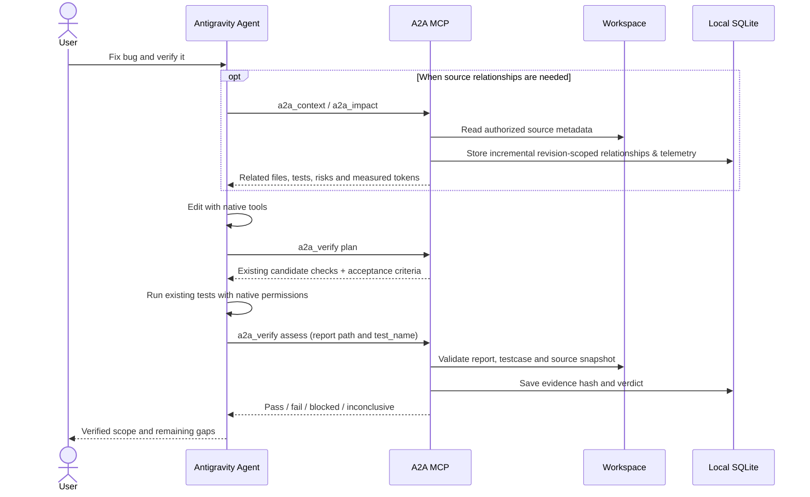

# A2A Technical Architecture

## Mission and invariants

1. **Native ownership:** all planning, reasoning, coding, browser, terminal, permissions, and orchestration remain Antigravity's responsibility.
2. **No claim without evidence:** compilation is not functional verification; evidence is bound to a source snapshot and a machine-readable completed test report with a named case.
3. **No knowledge without provenance:** extracted relationships distinguish observed source facts from filename or test-name heuristics.
4. **Configurable operating modes:** `always-on` (default) engages A2A proactively via `rules/AGENTS.md` and `hooks.json`; `on-demand` restricts A2A to explicit invocation.
5. **Local safety:** no external network access, arbitrary shell tool, or automatic dependency installer.

## Module boundaries

| Module | Inputs | Outputs | Must not do |
| --- | --- | --- | --- |
| `security` | canonical path, relative path, allowlist, settings | authorization, protected-root filtering, path safety | upward-authorize ancestors, follow symlinks |
| `scanner` | authorized workspace files, cached `(mtime, size)` | file hashes, language, symbols/imports | run project scripts, send source contents to remote API |
| `storage` | validated structured records | incremental SQLite state (`a2a.sqlite`) & telemetry | store raw source code, execute repo commands |
| `graph` | revision-specific nodes and edges | batched scoped queries and bounded impact | promote derived edges to verified facts |
| `tokens` | source text/bytes, `transcript.jsonl`, telemetry | lexer-safe skeletons, measured savings, session metrics | fabricate efficiency percentages |
| `verification` | named criteria and test report | status, evidence hash, revision-bound result | claim an untested behavior passed |
| `engine` | authorized MCP/CLI request | aggregated structured outputs | override Antigravity policy |
| `mcp` | JSON-RPC 2.0 stdio messages | 4 `a2a_*` tools (+ opt-in legacy aliases) & 4 resources | expose generic shell or credentials |

## Sequence diagrams

## Graph construction

The index is created by walking readable source/configuration files (non-recursive symlinks are skipped), using `(mtimeMs, size)` fast-path caching with a racy-stat guard to avoid re-reading unchanged files. Binary, generated, lockfile, sensitive, and oversized files are excluded. Each indexed file receives a `file:<relative-path>` node and SHA-256. Comment-aware syntax patterns add symbol definitions and local imports; feature relationships derived from filenames are marked `derived`. A filename-matched test edge is a **candidate**, not guaranteed coverage.

Queries search node labels or paths, then retrieve batched adjacent edges. Impact analysis performs bounded breadth-first traversal prioritizing `IMPORTS` and `MAY_TEST` edges without expanding across unrelated `CONTRIBUTES_TO` feature siblings.

## Revision & evidence design

`revision_id = SHA256(workspace_id + SHA256(GitHEAD + sorted(path:fileHash)))` truncated. Unlike a Git commit alone, this includes uncommitted modifications. `workspaces.current_revision_id` tracks the active snapshot so reverting via `git checkout` or undo immediately restores cache hits. Historical runs are preserved, with `fresh=false` when evidence is no longer applicable.

## Verdict rules

- `failed` if any required mapped case fails.
- `blocked` if a required check cannot run and no required check has failed.
- `passed` only if all requested criteria match completed positive machine-readable assertions.
- `inconclusive` for absence of evidence, incomplete/invalid report, skipped assertions or missing named test case.
- `stale` is a **read-time freshness flag**, not a historical run verdict.

## Operational model

A `node` subprocess handles one JSON-RPC request per stdin line, responds on stdout, and stores the graph in `a2a.sqlite` inside `PLUGIN_DATA`. A lightweight `hooks.json` (`SessionStart`, `PreInvocation`, `PostToolUse`) records `active-session.json` so `a2a_context(action="tokens")` resolves the active conversation transcript accurately. No HTTP listener is started.

## Deliberate exclusions

- No extra coding agent, multi-agent orchestration, model proxy or undocumented Antigravity interface.
- No database server, embeddings API or vector store.
- No browser automation replacement.
- No automatic test command execution (test scripts can have side effects).
- No code modifications in scanned repositories.
- No claim of comprehensive symbol resolution for every language.
