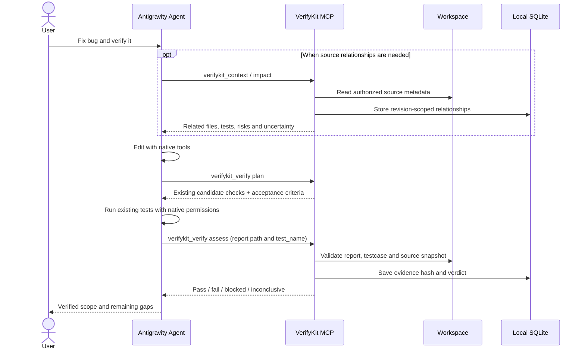

# VerifyKit Technical Architecture

## Mission and invariants

1. **Native ownership:** all planning, reasoning, coding, browser, terminal, permissions, and orchestration remain Antigravity's responsibility.
2. **No claim without evidence:** compilation is not functional verification; evidence is bound to a source snapshot and a machine-readable completed test report with a named case.
3. **No knowledge without provenance:** extracted relationships distinguish observed source facts from filename or test-name heuristics.
4. **No mandatory intervention:** VerifyKit's four MCP tools are invoked on demand. No hooks, always-on rules, or background agents.
5. **Local safety:** no external network access, arbitrary shell tool, or automatic dependency installer.

## Module boundaries

| Module | Inputs | Outputs | Must not do |
| --- | --- | --- | --- |
| `security` | canonical path, relative path, allowlist | authorization and path safety | auto-authorize, follow symlinks |
| `scanner` | authorized workspace files | file hashes, language, symbols/imports | run project scripts, send source contents to remote API |
| `storage` | validated structured records | transactional SQLite state | store raw source code, execute repo commands |
| `graph` | revision-specific nodes and edges | scoped queries and bounded impact | promote derived edges to verified facts |
| `verification` | named criteria and test report | status, evidence hash, revision-bound result | claim an untested behavior passed |
| `engine` | authorized MCP request | aggregated structured outputs | override Antigravity policy |
| `mcp` | JSON-RPC 2.0 stdio messages | four tools | expose generic shell or credentials |

## Sequence diagrams

## Graph construction

The index is created by walking readable source/configuration files (non-recursive symlinks are skipped). Binary, generated, sensitive and very large files are excluded. Each indexed file receives a `file:<relative-path>` node and SHA-256. Simple deterministic syntax patterns add symbol definitions and local imports; feature relationships derived from filenames are marked `derived`. A filename-matched test edge is a **candidate**, not guaranteed coverage.

Queries search node labels or paths, then retrieve limited adjacent edges. Impact analysis performs bounded breadth-first traversal in both directions for explicitly supplied files or Git working tree changes. Runtime bindings, event buses, reflection and dynamic imports may be invisible to static analysis. Missing tests and heuristic edges affect the risk signals.

Graph complexity: `O(F+B+E)` to index `F` source files with `B` bytes of source and `E` extracted relationships. Impact queries are bounded by depth <= 4 and 350 visited nodes. Each query synchronizes source hashes to prevent stale graph reuse; this deliberate correctness choice can be expensive on large repositories and must be profiled before optimizing with mtime caches.

## Revision & evidence design

`revision_id = SHA256(workspace_id + SHA256(GitHEAD + sorted(path:fileHash)))` truncated. Unlike a Git commit alone, this includes uncommitted modifications. When report files or source change, freshness checks compare current revision plus the original report SHA-256. Historical runs are preserved, with `fresh=false` when evidence is no longer applicable.

A test report has a trust level of `local-report-not-cryptographically-attested`. A malicious repository could fabricate its own reports; native build/test review remains essential. Named testcase binding prevents unrelated passing suites from automatically satisfying arbitrary criteria.

## Verdict rules

- `failed` if any required mapped case fails.
- `blocked` if a required check cannot run and no required check has failed.
- `passed` only if all requested criteria match completed positive machine-readable assertions.
- `inconclusive` for absence of evidence, incomplete/invalid report, skipped assertions or missing named test case.
- `stale` is a **read-time freshness flag**, not a historical run verdict.

## Operational model

A `node` subprocess handles one JSON-RPC request per stdin line, responds on stdout, and stores the graph in `PLUGIN_DATA`. Antigravity's MCP lazy schema loading is retained. Node warnings and crash errors go to stderr. No HTTP listener is started. The local allowlist exists under the user's configuration directory and can only be changed using the explicit CLI. All workspace paths are canonicalized, bounded, and checked for symlinks.

## Deliberate exclusions

- No extra coding agent, multi-agent orchestration, model proxy or undocumented Antigravity interface.
- No database server, embeddings API or vector store.
- No browser automation replacement.
- No automatic test command execution (test scripts can have side effects).
- No code modifications in scanned repositories.
- No claim of comprehensive symbol resolution for every language.
